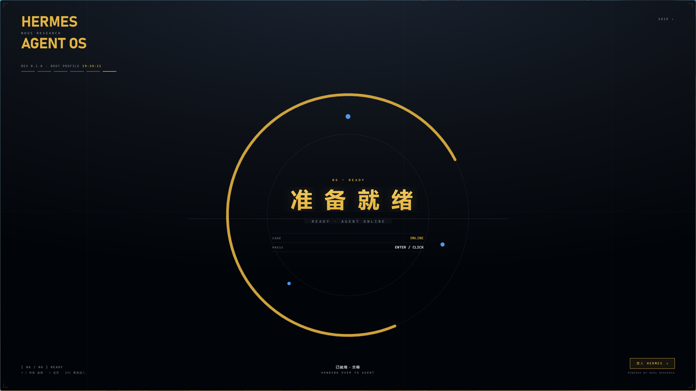
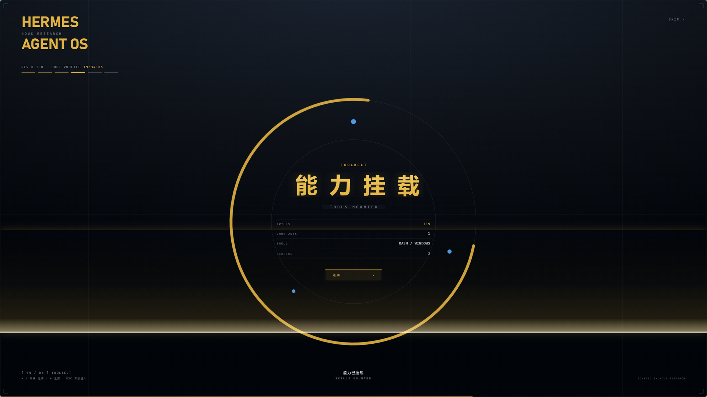
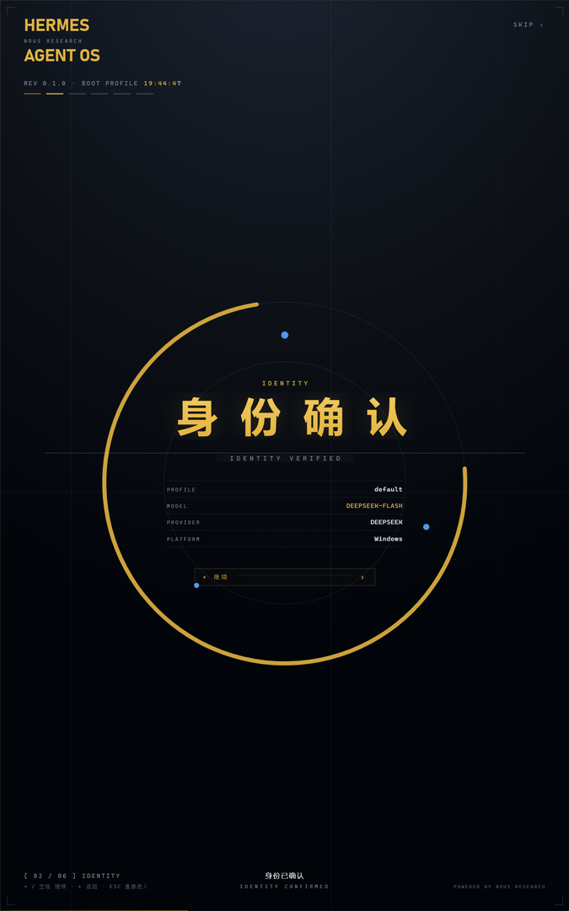

# Hermes 开屏动画 · Hermes Boot Splash

给 [Hermes Agent](https://hermes-agent.nousresearch.com/docs) 桌面端做的一块 **六环节开机屏**：GitHub 深色底配金、HUD 式排版，点「继续」一页页推进，最后一页点「进入 HERMES」才交棒。

一个独立 Electron 窗口，**不改 Hermes 本体**，更新不会被冲掉。

## 它做了什么

- **和 Hermes 同时启动**，动画盖住的是本来就要等的时间，不吃额外耗时
- **六页真实数据**：profile / model / provider / 技能数 / 记忆体积 / cron 条数 / 屏幕数，直接从 `%LOCALAPPDATA%\hermes` 读
- **跟随屏幕**：记住上次 Hermes 落在哪块屏 → 没记录用鼠标所在屏 → Hermes 窗口出现后若在别处则跟过去
- **每页一道金色扫描带**从上压到底，随后正文逐行落位
- **细长按钮**：左端小方块 + 虚线引导 + 悬停时金线从左填满、光泽从左扫到右

| 扫描 | 竖屏 |
|---|---|
|  |  |

## 六个环节

| # | 页面 | 内容 |
|---|---|---|
| 01 | 系统启动 `SYSTEM BOOT` | 核心状态 / profile / model |
| 02 | 身份确认 `IDENTITY VERIFIED` | profile / model / provider / 平台 |
| 03 | 记忆载入 `MEMORY LOADED` | 记忆体积 / 用户档案 / 是否持久 |
| 04 | 能力挂载 `TOOLS MOUNTED` | 技能数 / cron 条数 / shell / 屏幕数 |
| 05 | 链路接通 `CHANNELS LINKED` | 桌面 / 网关 / 微信 |
| 06 | 系统就绪 `SYSTEM READY` | 核心状态 + 进入 |

## 安装

前置：Windows 10/11 + Hermes Agent 桌面端（它的 `node_modules` 里自带 Electron，本程序直接复用，不额外装）。

1. 克隆或下载到任意目录（路径可以带空格）
2. 双击 **`安装快捷方式.vbs`**
   - 桌面只生成一个 `Hermes`（带开屏动画），不留第二个图标
   - 原来的 Hermes 快捷方式会备份到本目录 `backup\Hermes-原版.lnk`，桌面保持干净
   - 早期版本遗留的 `Hermes(无动画).lnk` 会被自动清掉
3. 双击 `Hermes`，第一页就是开屏

想临时跳过开屏：直接运行 `%LOCALAPPDATA%\hermes\hermes-agent\apps\desktop\release\win-unpacked\Hermes.exe`。

## 操作

| 操作 | 效果 |
|---|---|
| `→` / `空格` / `回车` / 点「继续」 | 下一环节 |
| `←` | 上一环节 |
| `ESC` / 右上角 `SKIP` | 直接进入 Hermes |
| 触控板下滑 | 翻页 |

最后一页若核心还没起好，按钮显示「等待核心…」，等它好了自动进入；就绪后 60 秒无人操作也会自己交棒。

## 自定义

改 **`splash.html`** 这一个文件：

- 文案与环节：`buildSteps()`
- 配色：顶部 `:root`（`--bg` / `--gold` / `--blue` / `--dim`）
- 圆环直径：`--d`，正文所有字号、行距、按钮宽度都按它等比缩放，所以竖屏/高 DPI 不会把小字挤出圆环

改完存盘，双击 **`预览动画.vbs`** 看效果（每 4.2 秒自动翻页，你一动手就停下让你自己翻）。桌面图标本来就走这套，不用重装。

## 环境变量（排查用）

| 变量 | 作用 |
|---|---|
| `SPLASH_PREVIEW=1` | 只放动画，不拉 Hermes |
| `SPLASH_FORCE=1` | 无视「Hermes 已在运行」 |
| `HERMES_EXE=...` | 换掉要启动的程序（拿记事本验证过整条流程） |
| `HERMES_PROC=...` | 就绪探测用的进程名，默认取 `HERMES_EXE` 的文件名 |
| `SPLASH_AUTO_MS=60000` | 就绪后多久自动进入 |
| `SPLASH_IGNORE_MEMORY=1` | 不参考上次的屏幕，直接用鼠标所在屏 |

## 文件

| 文件 | 作用 |
|---|---|
| `splash.html` | 动画本体：分镜、配色、交互 |
| `main.js` | 窗口、读盘数据、拉起 Hermes、探测主窗口就绪、跟随屏幕 |
| `preload.js` | 窄桥：`info()` / `exit()` / `ready` / `done` |
| `启动 Hermes.vbs` | 快捷方式指向它；找不到 Electron 就直启本体 |
| `预览动画.vbs` | 只放动画，不拉 Hermes |
| `安装快捷方式.vbs` | 建桌面快捷方式（只建一个；原版备份进 `backup/`） |
| `docs/` | 截图 |

## 已知取舍

- 复用 Hermes 自带 Electron，所以 **必须先装 Hermes 桌面端**；Hermes 重建时会重装 `node_modules`，路径不变
- Windows 会把创建时高过主屏的窗口压扁，所以 `ready-to-show` 里会再用 `setBounds` 贴一次整屏
- VBS 必须存成 **UTF-16LE + BOM**，且 `sh.Run` 的窗口样式必须是 `1`（用 `0` 会把 Electron 自己的窗口一起藏掉）

## License

MIT
